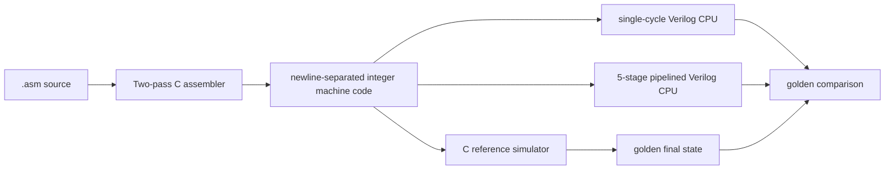
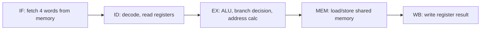
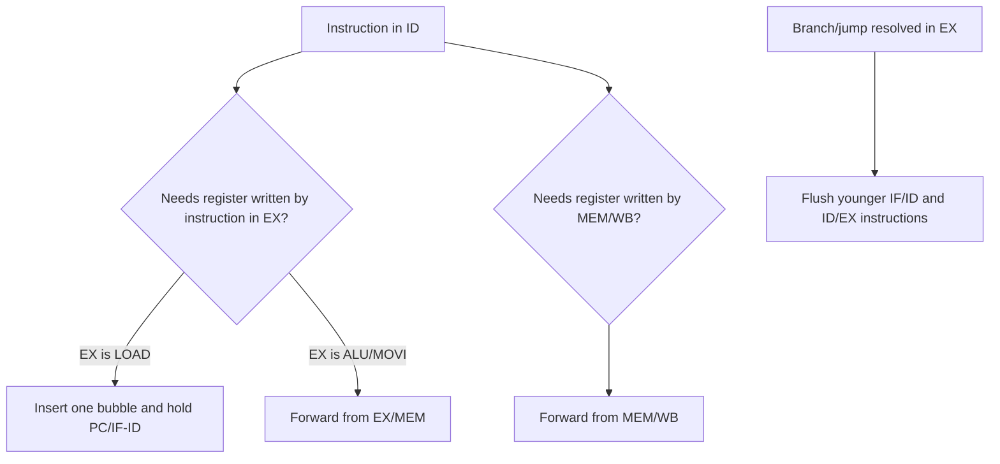

# Custom RISC ISA And Pipeline Spec

This document is the compact architecture reference for the Custom RISC CPU Simulator project.

## Machine Model

- 8 general-purpose 32-bit registers: `R0` through `R7`.
- `R7` is the stack pointer by convention in the C simulator and single-cycle Verilog CPU.
- 256-word shared instruction/data memory.
- Fixed-width 4-word instruction encoding:

```text
[opcode] [a] [b] [c]
```

Since each instruction consumes four memory words, all branch and jump targets are word-aligned bytecode addresses: `0`, `4`, `8`, and so on.

## Datapath Overview



## Pipeline Stages



The pipelined Verilog core includes:

- IF/ID, ID/EX, EX/MEM, and MEM/WB pipeline registers.
- EX/MEM and MEM/WB forwarding paths.
- Writeback-to-decode bypassing.
- Load-use stall detection.
- Branch and jump flushes.
- Cycle, retired-instruction, stall, flush, and CPI reporting.

## Pipeline Hazard Policy



## Pipeline Core ISA Coverage

The C simulator and single-cycle Verilog CPU support the full ISA:

- Arithmetic and moves: `MOVI`, `ADD`, `SUB`, `ADDI`
- Logic and shifts: `AND`, `OR`, `XOR`, `SHL`, `SHR`
- Memory: `LOAD`, `STORE`, `LOADR`, `STORER`
- Control flow: `JMP`, `BEQ`, `BNE`, `JLT`, `JGT`, `HALT`
- Stack/subroutines: `PUSH`, `POP`, `CALL`, `RET`

The pipelined Verilog CPU currently supports the scalar, branch, and memory subset:

- `NOP`, `LOAD`, `STORE`, `MOVI`, `ADD`, `SUB`, `JMP`, `BEQ`, `BNE`, `HALT`
- `ADDI`, `AND`, `OR`, `XOR`, `SHL`, `SHR`, `LOADR`, `STORER`, `JLT`, `JGT`

Stack/subroutine instructions are still handled by the C simulator and single-cycle Verilog CPU. They are intentionally left out of the first pipelined core so the initial pipeline can focus on classic data/control hazards.

## Golden Model Rule

The C simulator is the behavioral reference model. For regression testing:

1. The assembler converts an assembly program into `.mem` machine code.
2. The C simulator runs it and writes a final state file with registers and memory.
3. The single-cycle Verilog CPU runs the same `.mem`.
4. The test script compares Verilog final registers and `MEM[250]` to the C golden state.
5. The pipeline Verilog CPU runs supported programs and checks `MEM[250]` against the same C result.

